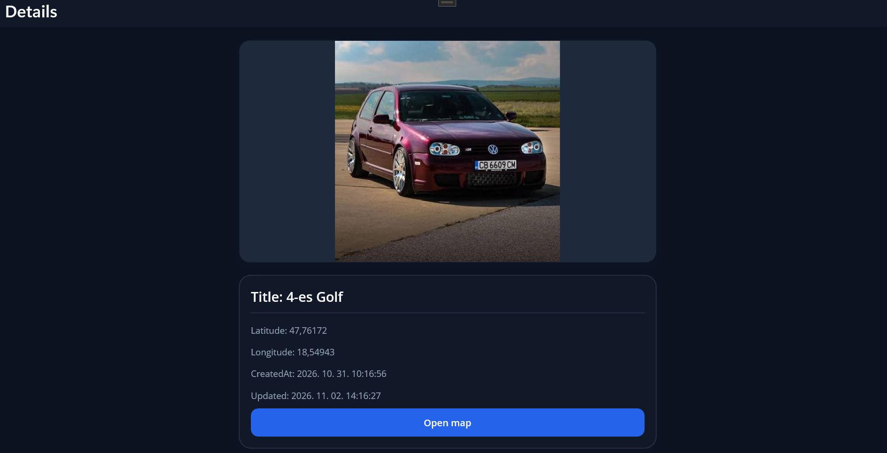

  <h1>PhotoDrive</h1>
  
<b>A cross-platform photo gallery application built with .NET MAUI, MVVM, and SQLite.</b>

  
  
  
  

---

## Overview

PhotoDrive is a university project for capturing, organizing, and managing photos. It stores image metadata in a local SQLite database, keeps image files in application storage, and follows the MVVM pattern to separate the user interface from application logic.

---

## Screenshots

---

## Key Features

- Capture photos directly from the device and preview them before saving
- Store titles, timestamps, and geolocation data for each image
- Browse photos in a responsive gallery and open a detailed view
- Edit image metadata or delete images from both storage and the database
- Synchronize SQLite records with locally stored image files

---

## Architecture and Design Patterns

- **MVVM:** ViewModels expose observable state and commands to XAML views through data binding.
- **Centralized image service:** A single service coordinates focused database and file-storage services.
- **Result pattern:** Operations return explicit success or failure results for predictable error handling.
- **Dependency injection:** Pages, ViewModels, and services are registered and composed through the MAUI service container.
- **Weak-reference messaging:** ViewModels communicate user-facing status and error messages without tight coupling.

---

## What I Learned

- Applying the Result pattern to service operations
- Splitting services into smaller responsibilities and composing them behind a central service
- Building application logic with ViewModels, bindings, and commands
- Passing data between pages with Shell query parameters
- Managing streams safely when saving captured images
- Handling failures consistently across database, file, location, and camera operations
- Using `WeakReferenceMessenger` for loosely coupled communication

---

## Tech Stack

| Area | Technology |
|---|---|
| Application | C#, .NET 10, .NET MAUI |
| Architecture | MVVM, CommunityToolkit.Mvvm |
| User interface | XAML, data binding, relay commands |
| Database | SQLite, sqlite-net-pcl |
| Device APIs | Camera, geolocation, local file storage |

